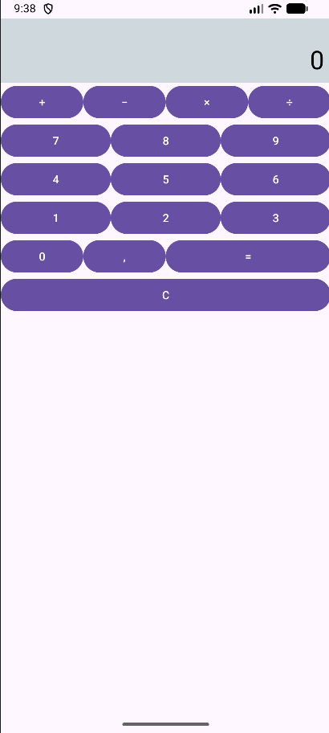

# Kalkulator — układy LinearLayout
## Opis projektu
Projekt przedstawia interfejs kalkulatora zbudowany wyłącznie w XML, przy użyciu zagnieżdżonych elementów LinearLayout. Przyciski są klikalne, ale nie wykonują jeszcze obliczeń.

---

## Zagnieżdżenie układu

### Układ ma 2 poziomy elementów LinearLayout:
- Główny LinearLayout o orientacji pionowej.
- Zagnieżdżone LinearLayout o orientacji poziomej, które tworzą rzędy przycisków.

Jeśli liczymy całą hierarchię widoków, łącznie z kontrolkami, mamy maksymalnie 3 poziomy: główny układ, rząd przycisków i przyciski w tym rzędzie. Wyświetlacz i przycisk C są bezpośrednimi elementami układu głównego.

Wagi przycisków w ostatnim rzędzie

### Przyciski mają następujące wagi:

- 0 - layout_weight="1".
- , - layout_weight="1".
- = - layout_weight="2".

Suma wag wynosi 4. Przyciski 0 i , otrzymują po jednej czwartej dostępnej szerokości, natomiast przycisk = otrzymuje dwie czwarte. Dzięki temu jest dwa razy szerszy od każdego z pozostałych przycisków.

Wszystkie przyciski mają layout_width="0dp", a ich szerokość jest wyliczana na podstawie wag, bez stosowania sztywnych szerokości w dp.

## Zrzut ekranu

